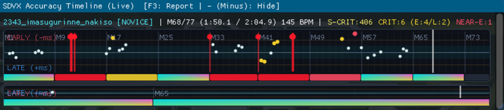
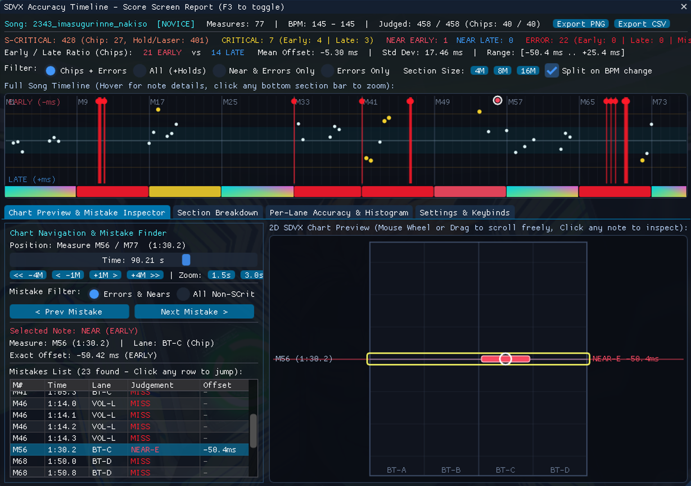
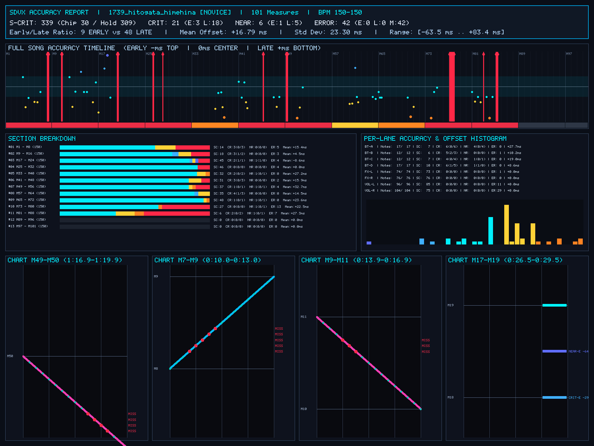

# SDVX Accuracy Timeline (`sdvx_accuracy.dll`)

Inspired by iidx's accuracy timeline, this serves as a real-time **Note Accuracy Timeline**, **Interactive 2D Chart Preview & Mistake Inspector**, as well as **Score Screen Section Analyzer** mod for **SOUND VOLTEX EXCEED GEAR / Nabla** (`modules/soundvoltex.dll`), built on top of the **Spice2x SDK (D3D9)** and **Dear ImGui**.

Designed to coexist seamlessly alongside other hooks and game versions.

---

## Preview

### Live Gameplay HUD
> *Displays a live full-song timeline, 8-second rolling zoom strip, measure markers, BPM changes and real-time Early/Late & offset statistics while playing.*



### Score Screen Accuracy Report & Section Breakdown
> *Automatically opens on the Result / Score screen (`CResultScene`) to show where Early, Late, Critical, Near, and Error judgements occurred across every section of the chart.*



### Interactive 2D Chart Preview & Mistake Inspector
> *Renders the full SDVX 6-lane + 2-laser chart (`BT-A..D`, `FX-L/R`, `VOL-L/R`) overlaid with your exact judgement grades and offsets in `±ms`. Jump directly between mistakes or scrub freely through the entire chart.*

### Per-Lane Breakdown, Timing Histogram & PNG/CSV Export
> *Detailed accuracy and mean `±ms` offset per button/lane alongside a `-60ms` to `+60ms` timing distribution histogram, plus one-click export to high-resolution `.png` and `.csv`.*



---

## Features

- **Live Gameplay Accuracy Timeline**:
  - Plots every judged note in real time from `0:00` to the end of the chart against its exact millisecond offset (`-ms EARLY` vs `+ms LATE`).
  - **8-Second Rolling Zoom Strip** for high-visibility inspection of recent patterns.
  - Live header displaying current Measure (`M1..MN`), Song Timer, active BPM, `S-CRIT`, `CRIT (Early/Late)`, `NEAR (Early/Late)`, `ERROR`, Mean Offset (`ms`), and Standard Deviation (`ms`).
- **Interactive 2D SDVX Chart Preview & Mistake Inspector**:
  - Parses `#TRACK1`–`#TRACK8` from the `.vox` chart to render an authentic 2D SDVX highway showing **BT-A..D**, **FX-L/R** chips & long holds, and **VOL-L / VOL-R** lasers.
  - Overlays your actual judgement grade (`S-CRIT`, `CRIT-E/L`, `NEAR-E/L`, `ERR-E/L`, `MISS`) and exact `±ms` timing offset directly on each note.
  - **Free Navigation**: Scrub through the entire chart using the time slider, click-and-drag directly on the highway, or jump by measure (`-4M`, `-1M`, `+1M`, `+4M`) with adjustable zoom (`1.5s`, `3.0s`, `5.0s`).
  - **Mistake Finder**: Click **`< Prev Mistake`** / **`Next Mistake >`**, click any row in the **Mistakes List**, or click any dot on the **Full-Song Timeline** to lock onto the exact note where you missed or hit early/late. What kind of judgements are considered "mistakes" is configurable in the **Settings & Keybinds** tab.
- **Automatic Score Screen Analyzer (`CResultScene`)**:
  - Automatically pops up when entering the Result / Score screen (can also be toggled anytime via hotkey).
  - **Interactive Full-Song Timeline**: Hover over any note or section for exact timestamp, measure number, lane, judgement grade, and `±ms` offset.
  - **One-Click Section Zoom**: Click any section in the bottom health bar or in the section table to open a dedicated zoomed-in timeline for that phrase.
  - **Quick Filters**: Filter the timeline by *Chips + Errors*, *All Notes (+Holds/Lasers)*, *Near & Errors Only*, or *Errors Only*.
- **Musical Section Breakdown (`.vox` Chart Parser)**:
  - Groups measures into customizable sections (**4M**, **8M**, or **16M** measures per section, with optional automatic splitting on major BPM changes).
  - Displays a visual stacked accuracy bar, Early/Late counts, mean `ms` offset, and status badge (`ALL S-CRIT`, `UC (EARLY)`, `UC (LATE)`, `NEAR (EARLY/LATE)`, `ERRORS`) for every section.
- **One-Click PNG & CSV Export (`exports/` folder)**:
  - **Export PNG**: Generates a standalone `1800×1350` high-resolution summary image (`exports/<song>_<diff>_<timestamp>.png`) containing the full-song accuracy timeline, section breakdown bars, per-lane stats, timing histogram, and 4 visual 2D Chart Highway snapshots of your mistake windows.
  - **Export CSV**: Exports a complete dataset (`exports/<song>_<diff>_<timestamp>.csv`) with overall KPIs, per-lane statistics, section-by-section metrics, and the full chronological note-by-note judgement log.
- **In-Game Keybind Customization**:
  - Rebind hotkeys directly from the **Settings & Keybinds** tab. All preferences and window positions are saved automatically to `sdvx_accuracy.ini` and `sdvx_accuracy_config.ini`.

---

## Color Legend

| Judgement | Color | Description |
| :--- | :--- | :--- |
| **S-CRITICAL** | Ice White / Cyan (`#E8FCFF`) / Rainbow Bars | Within S-Critical timing window (`±16.67ms` for chips, plus Hold/Laser ticks); `ALL S-CRIT` sections display a rainbow gradient |
| **CRITICAL** | Gold / Yellow (`#FFDA2D`) | Critical hit (`±16.67ms .. ±33.33ms`) |
| **NEAR (EARLY)** | Red (`#FF4B64`) | Early Near hit |
| **NEAR (LATE)** | Blue (`#379BFF`) | Late Near hit |
| **ERROR (Early / Late / Miss)** | Crimson Red (`#FF1928`) | Full-height vertical marker + dot |

---

## Installation & Usage

1. Copy **`sdvx_accuracy.dll`** into your Sound Voltex game root directory (next to `spice64.exe`).
2. Add `sdvx_accuracy.dll` to your Spice2x `-k` hook DLL list (via `spicecfg.exe` under **Inject Hook DLL (`-k`)**, or in your launch `.bat` script):
   ```bat
   spice64.exe -k ifs_hook.dll mikado.dll sdvx_training.dll sdvx_accuracy.dll ...
   ```
3. Launch the game. A Spice2x toast notification will confirm that **SDVX Accuracy Timeline** is loaded.

---

## Default Hotkeys

Default hotkeys are chosen so they do **not** conflict with Spice2x (`F9`–`F12`), `sdvx_training.dll` (`Insert`, `Delete`, `Home`, `End`, `PgUp`, `PgDn`, `Tab`, `Space`, `Arrows`), or standard SDVX keypad/controller bindings:

| Action | Default Key | Configurable? |
| :--- | :---: | :--- |
| **Toggle Full Accuracy Report Window** | **`F3`** | Yes (in *Settings & Keybinds* tab or `sdvx_accuracy_config.ini`) |
| **Toggle Live Gameplay Timeline HUD** | **`- (Minus)`** | Yes (in *Settings & Keybinds* tab or `sdvx_accuracy_config.ini`) |

---

## Compatibility with other game versions

- Uses dynamic MSVC x64 RTTI discovery (`CompleteObjectLocator` / `TypeDescriptor`) and instruction-level offset resolution so it works across older and future 64-bit Exceed Gear / Nabla `soundvoltex.dll` builds without hardcoded RVAs.
- Uses thread-safe chained vftable hooks (`InterlockedExchangePointer`), allowing other hook DLLs to be loaded in any order.

---

## Building from Source

### Requirements
- Visual Studio 2022 / 2026 Build Tools (MSVC x64 C++20 compiler)
- Windows 10/11 SDK (`d3d9.lib`, `user32.lib`, `gdi32.lib`, `imm32.lib`)

### Build Steps
Run **`build.bat`** from the `sdvx_accuracy` folder:
```bat
cd sdvx_accuracy
build.bat
```
This compiles `sdvx_accuracy.cpp` and Dear ImGui (`v1.91` + `imgui_impl_dx9`) and outputs `sdvx_accuracy.dll` directly into the game directory.
